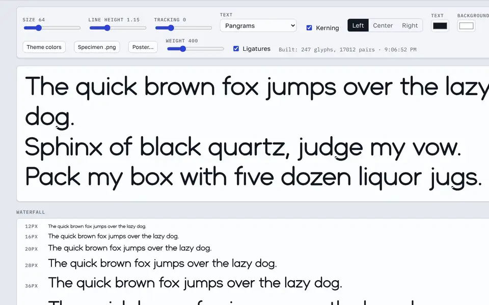
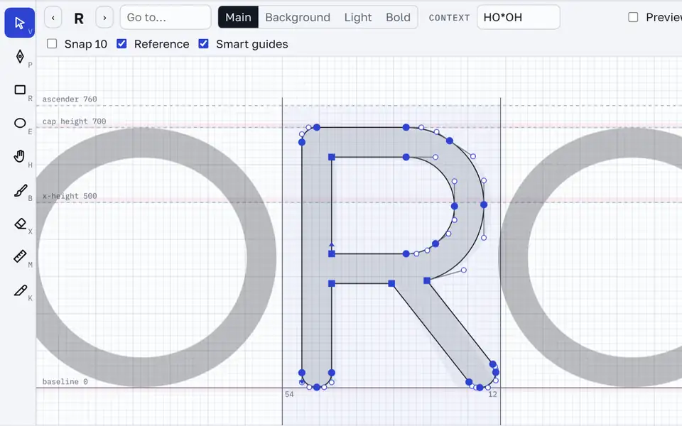
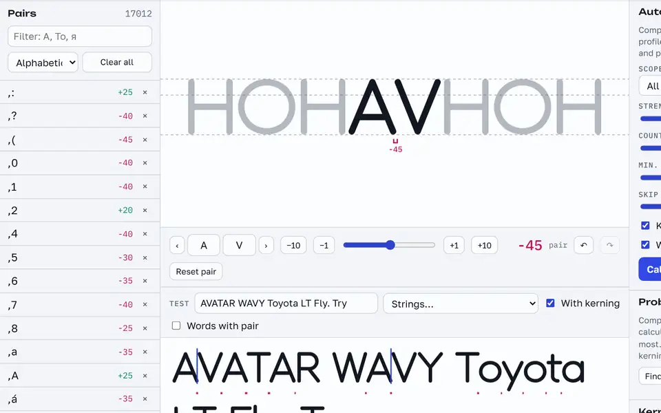
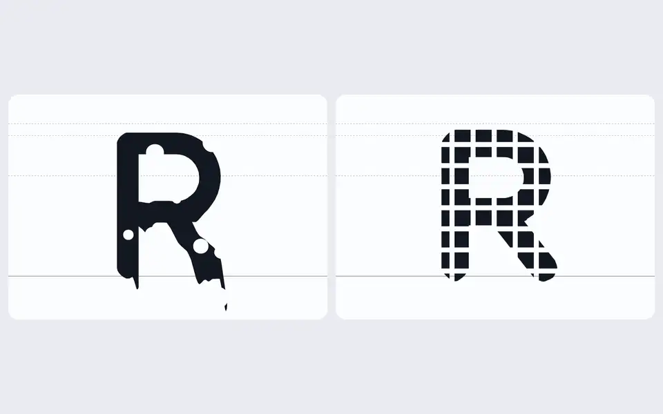
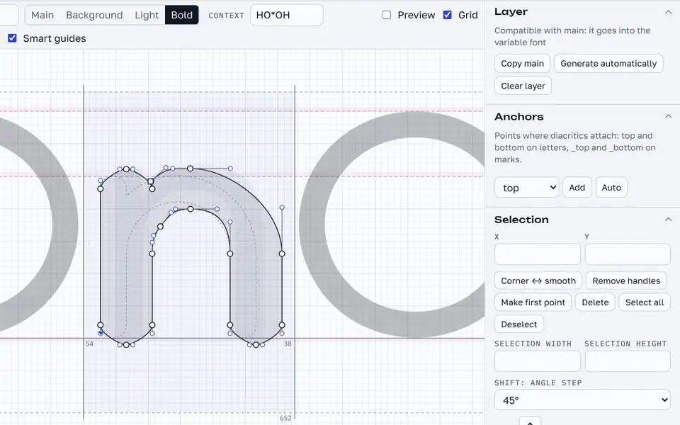
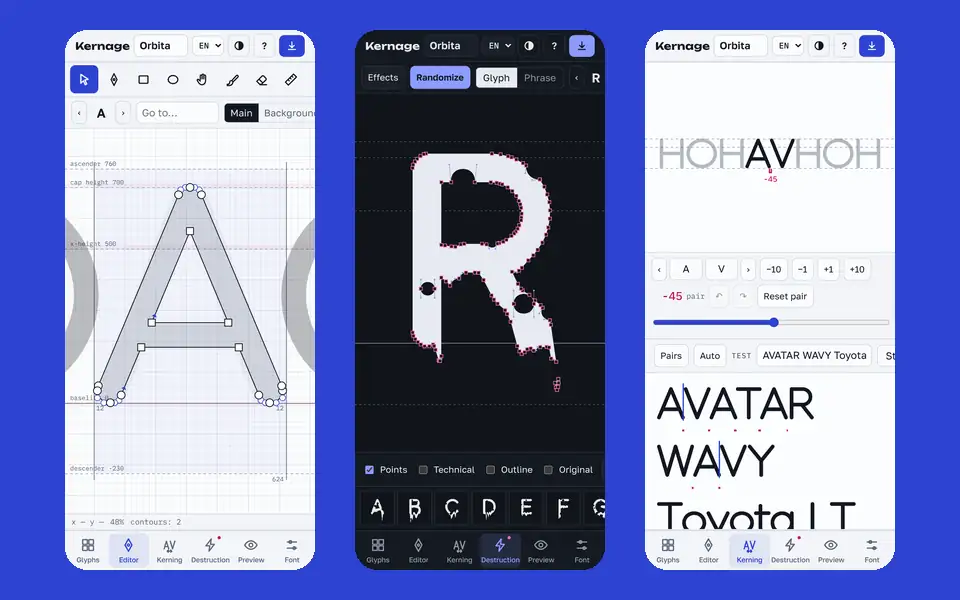
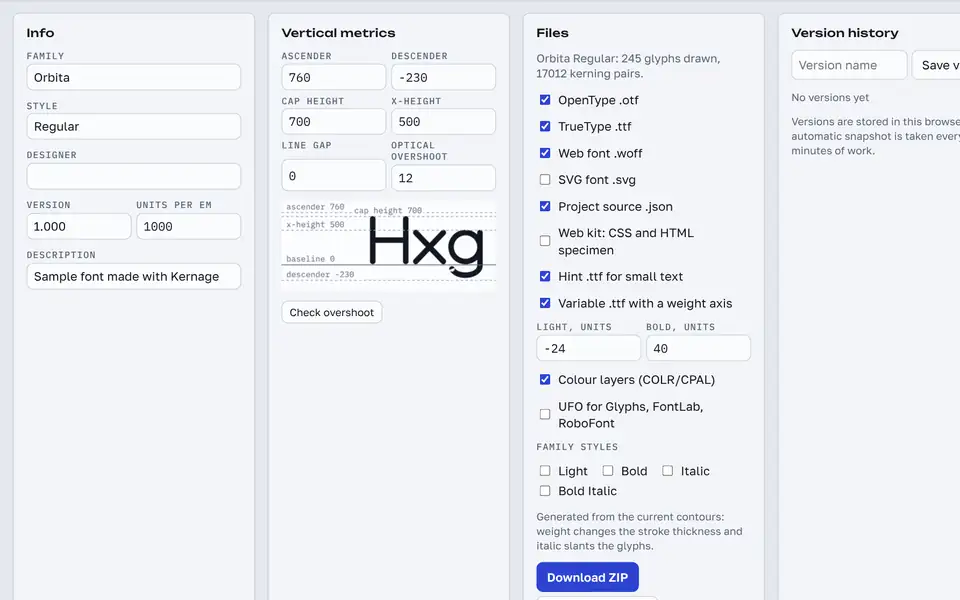

# Kernage — a font editor in your browser

[](https://github.com/gexhaw/kernage/actions/workflows/ci.yml)
[](LICENSE)

**[Open Kernage →](https://gexhaw.github.io/kernage/)** · [Download `kernage.html`](https://github.com/gexhaw/kernage/releases/latest)



**Kernage** is a complete font editor in a single HTML file. Draw letters, kern them, break them with effects, and export real `.otf`, `.ttf`, `.woff`, variable and colour fonts. It runs on desktop and mobile with no install, no account and no internet connection.

| Draw | Kern | Destroy |
|---|---|---|
|  |  |  |
| **Weight masters** | **Phone** | **Export** |
|  |  |  |

---

## Quick start

1. Download `kernage.html` from [Releases](https://github.com/gexhaw/kernage/releases/latest), or open the [web version](https://gexhaw.github.io/kernage/).
2. Open it in a browser (Chrome, Edge, Firefox or Safari) on a computer or phone.
3. Tap any letter in the grid and start drawing.
4. Press the arrow button in the header to download your font.

There is nothing to build or serve. All libraries and interface fonts are embedded in the file, so Kernage works offline.

> Open the file in a real browser. Built-in file viewers (Telegram, Files, mail apps) often don't run scripts. If Kernage can't start, a red notice appears at the bottom of the screen.

### Install as an app (PWA)

The [web version](https://gexhaw.github.io/kernage/) can be installed as an app. You can also host `kernage-pwa.zip` from Releases on any HTTPS static host. Visitors can then press **Install** in the header, or use "Add to Home Screen", and Kernage works offline as a standalone app.

---

## Features

### Glyphs
- A ready-made sample font, "Orbita", with Latin, Cyrillic, digits and punctuation (255 glyphs).
- Filters (Latin, Cyrillic, digits, symbols, empty, OpenType), search by character, `U+0416` or glyph name.
- If a search finds nothing, one click adds the missing character.
- Colour status labels and three card sizes.
- Add any character by code, plus ligatures (`fi`) and stylistic alternates (`a.ss01`).
- Diacritics builder: Western and Central European, Turkic and Cyrillic (Ё, Й, Ў). Kerning is copied from the base letters.
- OpenType generators: tabular figures (`tnum`) and small caps (`smcp`).
- **Bulk edits**: press **Select**, or Ctrl/⌘ + click cards, to move, scale, set sidebearings, labels or anchors on many glyphs at once. Each glyph keeps its own undo.

### Editor
- Tools: select, pen (Bézier), rectangle, ellipse, pressure-sensitive brush, eraser, ruler, **knife**, hand.
- **Layers**: a **Background** layer for a sketch or an alternative shape (swap it with the main drawing in one click), plus **Light** and **Bold** masters for the variable font. Generate a master automatically, then refine it by hand. Kernage checks that each master is compatible with the main drawing and tells you what differs.
- **Anchors**: `top` and `bottom` on letters, `_top` and `_bottom` on marks. Drag them on the canvas, type exact values, or place them automatically.
- **Metric formulas**: set a sidebearing to `=O`, `=|H` (the other side of H) or `=O+10`, and it follows when the source glyph changes.
- **Components**: reuse one glyph inside others, such as a serif or a bowl. Edit the source and every letter that uses it updates. Drag a component to move it, or decompose it into plain contours.
- **Shift snapping** to 15°, 45° or 90° for nodes, handles, the pen, the ruler and the knife.
- Exact coordinates: X/Y for any selection, plus width/height fields that scale a multi-point selection precisely.
- **Optical overshoot**: shaded overshoot zones on the canvas, a one-click fix for the current glyph, and a font-wide check with "Fix all".
- **Contour colours**: assign palette colours to contours. They export as COLR/CPAL colour layers.
- Boolean operations, corner rounding, extreme points, contour check and auto-fix.
- Rotate, scale, slant, flip, point alignment and smart guides.
- Sketch tracing: photograph a letter drawn on paper and turn it into contours.
- A context string (`HO*OH`) to see the glyph between its neighbours.
- Export a single glyph as SVG or PNG.

### Kerning
- **Auto-kerning** from glyph profiles, calibrated against HH and nn.
- **Kerning groups**: editing `AV` also applies to `ÀV`, `ÁV` and Cyrillic `АV`.
- **Problem pairs**: compares your kerning with a fresh calculation, lists the pairs that differ most, and applies them one by one or all at once.
- **Words with pair**: the test line fills with real words containing the selected pair (English, Russian and Spanish word lists).
- Auto-spacing for sidebearings.
- Manual kerning by dragging, slider, ±1/±10 buttons, and `[` `]` to step through test-line pairs.
- Separate undo and redo for kerning.

### Destruction
- 34 effects in three levels: "Mild mischief", "Vandalism" and "Apocalypse". They include wave, ripple, melt, echo, shards, cheese, grid, spikes, pixels, halftone and more.
- Built-in presets: Glitch, Melted cheese, Storm, Prison, Pixel art, Newspaper, Neon, Rust and others.
- **Your own presets**: save the current settings, then share them as a short `LFX1:` code that anyone can paste back in.
- **Animated export**: a looping GIF, or MP4/WebM video, of the effect building up.
- Randomize (`R`), seed control, live animation and sound.
- Apply effects at export, or bake them into the outlines and keep editing.

### Preview
- Live preview of the built font: size, line height, tracking, alignment and colours.
- Waterfall, glyph chart, and toggles for ligatures, `ss01`–`ss20`, `tnum` and `smcp`.
- A weight slider when the variable font is enabled.
- **Poster generator**: big letter, alphabet, word and text, or specimen layouts. Sizes for a post, a story, a cover or A4, with your colours, downloaded as PNG.

### Export
- **OpenType `.otf`**, **TrueType `.ttf`**, **WOFF `.woff`** and an SVG font.
- **Variable font** (`-VF.ttf`) with a `wght` axis from Light to Bold, including named instances and a STAT table. It uses your hand-drawn masters wherever they are compatible.
- **Colour font** layers (COLR v0 + CPAL) in OTF, TTF, WOFF and the variable font.
- Kerning in GPOS, written as class kerning when you use kerning groups, which keeps large fonts small. A `kern` table is included for older apps.
- **Mark positioning** (`mark`, `mkmk`): Kernage creates combining accents U+0300–U+0327, so `a` + ́ gives á, and stacked accents sit one above another.
- **Contextual alternates** (`calt`), written as simple rules such as `f [a] > a.ss01`, with a check for errors as you type.
- Ligatures, stylistic sets, `tnum` and `smcp` in GSUB.
- **Hinted TrueType**: an option aligns letters to the baseline, x-height and cap height at small sizes on Windows.
- Static family styles: Light, Bold, Italic and Bold Italic.
- **UFO 3** for Glyphs, FontLab and RoboFont, with glyphs, kerning, groups, `features.fea` and glyph order.
- A web kit: CSS `@font-face` and an HTML specimen.
- The project source as `.json`.

### Import
- `.json` (Kernage project), `.otf`, `.ttf`, `.woff` and `.woff2`. Kerning of any size comes across from GPOS (as kerning groups when the font uses classes), plus stylistic alternates, `tnum`, `smcp` and ligatures from GSUB. A variable font opens at its default instance.
- **UFO**, as a folder (desktop) or inside a `.zip`.
- **Glyphs** files (`.glyphs`, formats 2 and 3), using the first master, with components decomposed and kerning groups preserved.
- "Fill from font" to complete empty glyphs from another font.

### Projects, sharing and history
- Projects save automatically in the browser, and you can keep several fonts.
- **Version history**: named versions plus an automatic snapshot every 10 minutes of work, compressed and stored in IndexedDB, with one-click restore.
- **Share project**: sends the `.kernage.json` through the system share sheet on phones, or downloads it on desktop.
- **Project link**: when Kernage is hosted on a website, copies a link that contains the whole compressed project.

### Interface
- **Picture tour**: twelve illustrated slides that show what Kernage can do. Open it from the "How to start" card or from Help.
- Large, readable text and icons on desktop and on phones.
- English, Russian and Spanish. English is the default.
- Light, dark or system theme.
- A desktop layout with side panels, and a mobile layout with a bottom tab bar and slide-up sheets.

---

## Mobile

- Pinch to zoom and two-finger pan on the canvas.
- A loupe under your finger while dragging points.
- Two-finger tap to undo, three-finger tap to redo.
- Swipe across a glyph in Destruction to move to the next or previous glyph.
- Use the camera for sketches, and a stylus brush with pressure.
- Landscape mode and light haptic feedback.

---

## Keyboard shortcuts

| Keys | Action |
|---|---|
| `V` `P` `B` `X` `R` `E` `M` `K` `H` | select, pen, brush, eraser, rectangle, ellipse, ruler, knife, hand |
| `Space` + drag | pan the canvas |
| `Shift` while dragging | snap to 15° / 45° / 90° |
| `Ctrl+Z` / `Ctrl+Shift+Z` | undo / redo |
| `Ctrl+A`, `C`, `X`, `V` | select all, copy, cut, paste |
| `Ctrl+D` | duplicate selected contours |
| Arrows (+`Shift`) | nudge by 1 (10) |
| `[` `]` | previous / next glyph, or pair in Kerning |
| `F` | fit the glyph to the screen |
| Ctrl/⌘ + click a card | add the glyph to a bulk selection |
| `←` `→` in the tour | previous / next slide |
| `Alt`+click | toggle a corner or smooth point |
| `←` `→` in Kerning | ±10, with `Shift` ±1 |
| `R` in Destruction | randomize effects |
| `?` | help |

---

## Where data lives

Projects live in the browser's `localStorage` and versions in IndexedDB, on this device only. To move a font to another device or browser, use **Share project** or download the `.json` (Font → Project .json only) and open it there.

---

## Technology

- Plain HTML, CSS and JavaScript, with no framework. The source is split into modules that one script stitches into a single file.
- [opentype.js](https://github.com/opentypejs/opentype.js) 1.3.4 for OTF building (MIT).
- [polygon-clipping](https://github.com/mfogel/polygon-clipping) 0.15.7 for boolean operations (MIT).
- A custom sfnt writer for `glyf`/`loca`, `gvar`/`fvar`/`STAT`, `COLR`/`CPAL`, GPOS, GSUB, WOFF and ZIP, plus readers for ZIP, UFO and Glyphs.
- Interface fonts: Golos Text, IBM Plex Mono and Unbounded (SIL Open Font License).

---

## Development

The app ships as one HTML file. The source is split into modules that `tools/build.py` stitches together.

### Layout

```
src/
  template.html   markup, CSS and the placeholders the build fills in
  core.js         geometry, sample font, auto-kerning, sfnt/glyf/WOFF/ZIP writers, OTF import
  core2.js        kerning groups, composites (diacritics), helpers used by the UI
  core3.js        knife, offsets, weight masters, overshoot, tnum/smcp, variable font (fvar/gvar/STAT),
                  COLR/CPAL, GIF encoder, ZIP/UFO/Glyphs readers and the UFO writer
  core5.js        import: WOFF2 decoding, GPOS kerning of any size, GSUB alternates and ligatures
  core4.js        OpenType layout: GPOS (class kerning, mark, mkmk), GSUB (liga, ss, tnum, smcp, calt),
                  GDEF, anchors, combining marks, TrueType hinting, master compatibility
  fx.js           the 34 destruction effects and presets
  app.js          the interface: grid, editor, kerning, destruction, preview, font settings, export
  app_ext.js      v3 interface: components, palette, overshoot, words, versions, sharing, PWA
  app_ext2.js     v4 interface: layers and masters, anchors, calt, bulk edits, metric formulas, picture tour
  i18n.json       translations, keyed by the Russian source string: { "ru": ["en", "es"] }
assets/
  fonts.css       interface fonts as embedded WOFF2 subsets (SIL OFL)
  tour.js         picture-tour slides (WebP data URLs), made by tools/tour_*.py
  pwa/            service worker, manifest and icons for the installable build
vendor/           opentype.js 1.3.4, polygon-clipping 0.15.7, acorn (MIT), with licences
tools/
  build.py        src + assets + vendor -> dist/
  wrapjs.js       keeps every output line short and syntax-checks each <script>
  check_i18n.py   lists interface strings with no English or Spanish translation
  tour_shoot.py   screenshots the app for the tour
  tour_compose.py turns the screenshots into slides and writes assets/tour.js
tests/
  test_export.py  fonts from the sample project, checked with OTS, fontTools, HarfBuzz and FreeType
  test_ui.py      every tab in three languages on desktop and phone, the v4 features, the export ZIP
  run_all.sh      build + all checks
```

### Build

You need Python 3.8+ and Node.js 16+. Nothing is downloaded.

```
python3 tools/build.py
```

The build writes:

- `dist/kernage.html`: the app.
- `dist/kernage_test.html`: the same app wrapped in a full page, used by the tests.
- `dist/kernage-pwa.zip`: the installable version.

### Test

```
pip install -r tests/requirements.txt
python3 -m playwright install chromium
sh tests/run_all.sh
```

`test_export.py` builds OTF, hinted TTF, WOFF, variable and colour fonts. It then checks them with:

- **OTS**, the sanitizer in Chrome and Firefox. Each font must load.
- **HarfBuzz**, the shaper in Chrome, Firefox, Android and LibreOffice. It checks kerning pairs, mark attachment, mark stacking and `calt`.
- **FreeType**, the rasterizer on Android and Linux. It runs the TrueType hints at small sizes and checks that H and E share a cap height.
- **fontTools**, which checks the `fvar`/`gvar`/`STAT` tables and the `COLR`/`CPAL` colour layers.

### Translations

The interface is written in Russian in the source. Every string goes through `T('…')` or sits in the template. English and Spanish live in `src/i18n.json`. After you add text, run `python3 tools/check_i18n.py`. The script lists any string that still needs a translation.

### Rules the build relies on

- The libraries are inlined, so there are no network requests. The app works offline and in regions where CDNs are blocked.
- No output line is longer than about 1,500 characters, because some phone file viewers break long lines. `wrapjs.js` enforces this limit and fails the build on a syntax error.
- Projects are stored in `localStorage` and versions in IndexedDB. `normalize()` in `app.js` cleans up any project it loads, so add new glyph fields there.

### Releases and the web version

- Every push to `main` runs the tests (`.github/workflows/ci.yml`) and deploys the installable build to GitHub Pages (`pages.yml`).
- A tag such as `v4.0.0` attaches `kernage.html` and `kernage-pwa.zip` to a GitHub Release (`release.yml`).

## Author

Made by **gexhaw**: [GitHub](https://github.com/gexhaw) · [Instagram](https://www.instagram.com/gexhaw/)

## Licence

MIT, see [LICENSE](LICENSE). The bundled libraries and interface fonts keep their own licences. Fonts you create are yours.
